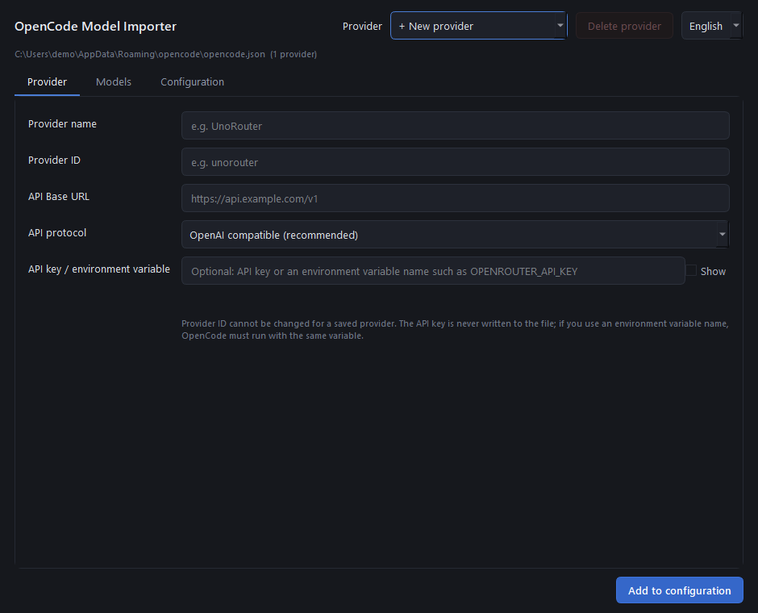

# OpenCode Model Importer

A small Windows desktop app that discovers models from any OpenAI-compatible API and writes them into
OpenCode's `opencode.json` / `opencode.jsonc` **without breaking comments, formatting, or existing settings**.

OpenCode's config editor does not cover third-party providers, and hand-editing JSONC is easy to break.
This tool does the boring part: fetch the model list, pick what you need, and save safely.


**Download:** grab `OpenCodeModelImporter.exe` from [Releases](../../releases/latest) — no Python
install needed. Building from source is documented below.



## Features

- **Model discovery** — reads `/models` from any OpenAI-compatible endpoint (UnoRouter, NVIDIA NIM,
  LM Studio, vLLM, ...), with filtering and multi-select.
- **Safe editing** — inserts only what is missing; existing providers, models, settings and JSONC
  comments stay byte-for-byte untouched. A timestamped backup is written before every save.
- **Provider management** — add, edit and delete providers, and add, rename or remove models.
- **OpenRouter provider routing** — fetch the real provider list for a model, tick providers, and the
  app writes `body.provider.order` plus the `service_tier` / `max_completion_tokens` values that
  OpenRouter needs for `/flex` and `/priority` endpoints.
- **No secrets in files** — the API key is used for the request only; the config gets the environment
  variable name (`env`) instead. TLS verification is never disabled.
- **English and Turkish UI** — switch from the selector in the header; the choice is remembered.
- **Never freezes** — all HTTP work runs on a worker thread.

## Requirements

- Windows (the UI is plain PySide6 and runs elsewhere too)
- Python 3.11+
- [OpenCode V2](https://opencode.ai) (config `providers` shape)
- PySide6 (installed with the requirements file)

## Install and run

```powershell
py -m pip install -r requirements.txt
py main.py
```

Or download the prebuilt Windows executable from [Releases](../../releases/latest).

> On this machine the `python` alias is broken; use `py`.

## Usage

**Add a provider.** Leave **+ New provider** selected and fill in:

1. **Provider name** — the label shown by OpenCode (e.g. `UnoRouter`).
2. **Provider ID** — the key in `opencode.json` (e.g. `unorouter`; `/` and `#` are rejected).
3. **API Base URL** — e.g. `https://api.unorouter.com/v1`.
4. **API protocol** — leave the default for OpenAI-compatible APIs.
5. **API Key / environment variable** — three options:
   - an environment variable name such as `OPENROUTER_API_KEY`: only the name is written to `env`,
     never the key itself;
   - the key itself: used for the model request only and never stored;
   - empty: no `Authorization` header is sent.
6. **Fetch models** → filter → tick → **Add to configuration**.

**Edit a saved provider.** Pick it from the list; name, URL, protocol and models are prefilled.
**Save changes** writes only the fields you changed.

**Remove models.** The same flow: saved models arrive ticked, so unticking removes them. Models that
the API no longer returns stay visible so they can still be removed.

**Model settings** (Models tab → select a model → **Model settings…**): OpenRouter-style variant suffix
(`:floor`, `:free`, `:nitro` …), `body.provider.order` (e.g. `particle-ai/us/flex, baseten`) and
`allow_fallbacks`. OpenCode V2 only forwards `body` fields to the request; a legacy V1
`options.provider` entry is moved to `body.provider` automatically when you save (after a backup).

When a checked provider ends in `/flex` or `/priority`, the app writes `body.service_tier` for you.
It also sets `body.max_completion_tokens` to the lowest output limit of the checked providers, so the
model request is not filtered out during OpenRouter routing (e.g. `particle-ai/us/flex` allows
131,072 output tokens). Switching providers recalculates or removes these values.

Use **Fetch providers** instead of typing slugs. It calls the public OpenRouter endpoint
`/api/v1/models/<author>/<model>/endpoints` and lists every provider with its exact slug and a tooltip
showing input/output price, context, output limit and quantization. Manually typed slugs are kept and
shown as “typed by hand”.

**Delete a provider** from the header. Confirmation is required, a backup is taken, and only that
provider (with its models) is removed.

**Language.** The selector in the header switches between English and Turkish immediately and is saved
for the next launch.

## What gets written

```jsonc
{
  "providers": {
    "unorouter": {
      "name": "UnoRouter",
      "package": "@opencode/ai/providers/openai-compatible",
      "env": ["UNOROUTER_API_KEY"],
      "settings": { "baseURL": "https://api.unorouter.com/v1" },
      "models": {
        "gemini-2.5-flash": {},
        "deepseek/deepseek-v4.1-flash-1017": {
          "name": "DeepSeek V4.1 Flash",
          "body": {
            "service_tier": "flex",
            "max_completion_tokens": 131072,
            "provider": {
              "order": ["particle-ai/us/flex"],
              "allow_fallbacks": false
            }
          }
        }
      }
    }
  }
}
```

A model is written as `{ "name": "..." }` when the API provides a display name, otherwise as `{}`.
Prices, context limits and capabilities are **never invented**: if the API does not return them, they
are not written.

## Safety rules

- Existing providers, models and settings are **never deleted without confirmation**. Only missing
  models are added, and only fields you changed are rewritten. Other keys under `settings`
  (`apiKey`, `headers`, …) survive a base URL change.
- Model removal applies only to models you unticked; provider deletion only when you confirm it.
- Already-saved models are skipped. When nothing changed, the file is not touched at all.
- Every save first creates `<file>.bak-<time>` (e.g. `opencode.json.bak-20261104-061121`).
- Writes use a temporary file plus an atomic replace; on failure the original is kept.
- JSONC comments and formatting are preserved — the file is edited in place, never reformatted.
- Invalid JSON/JSONC is rejected and the file is left alone.
- API keys are never written to the config or logged. TLS verification is never disabled.
- Configs that keep the credential in `settings.apiKey` (`"env://NAME"`) are left as they are, and the
  key field is locked so a second credential definition cannot appear.

## Tests

```powershell
$env:QT_QPA_PLATFORM="offscreen"; py -m unittest discover -s tests -v
```

53 tests, no network required (a local mock HTTP server is used). Coverage: requests with and without
a key, environment variables (defined/undefined), 401/403, 404 and missing `/models`, URL
normalization, multi-select and filtering, duplicate adds, model removal (comments and commas
included), renaming (`:floor`), `body.provider` routing and V1 migration, `service_tier`,
`max_completion_tokens`, OpenRouter endpoint parsing and the provider picker, provider deletion and
updates, `settings.apiKey` preservation, invalid JSON, backups, English/Turkish switching, and the
end-to-end GUI flow (add → edit → model settings → remove model → delete provider).

## Project layout

```
main.py                  entry point
ui/main_window.py        window, tabs, QThread workers, flow
ui/model_dialog.py       variant, OpenRouter provider picker, fallback
ui/worker.py             background worker (UI never blocks)
ui/theme.py              dark theme (QSS)
services/discovery.py    base URL normalization + /models request
services/openrouter.py   per-model OpenRouter endpoints (provider slugs)
services/credentials.py  key / environment variable resolution
config/jsonc.py          JSONC scanner that keeps comments intact
config/opencode_config.py load, validate, backup and atomic save
config/schema.py         provider/model JSON fragments, default paths
config/writer.py         add/update/delete providers, add/remove models
utils/i18n.py            English/Turkish strings
tests/                   unittest suite
```

## Türkçe

OpenAI uyumlu bir API'den modelleri keşfedip OpenCode yapılandırmanıza (`opencode.json` /
`opencode.jsonc`) güvenle ekleyen Windows aracı. Yorumları ve biçimi bozmadan yalnızca eksikleri
yazar, her kayıtta yedek alır, API anahtarını dosyaya koymaz. OpenRouter için `body.provider.order`
listesini gerçek sağlayıcı slug'larıyla doldurur; `/flex` ve `/priority` uçları için gereken
`service_tier` ile `max_completion_tokens` değerlerini kendisi ayarlar. Arayüz İngilizce ve Türkçe
arasında sağ üstteki seçiciyle anında geçiş yapar.

```powershell
py -m pip install -r requirements.txt
py main.py
```

## License

MIT — see [LICENSE](LICENSE).
